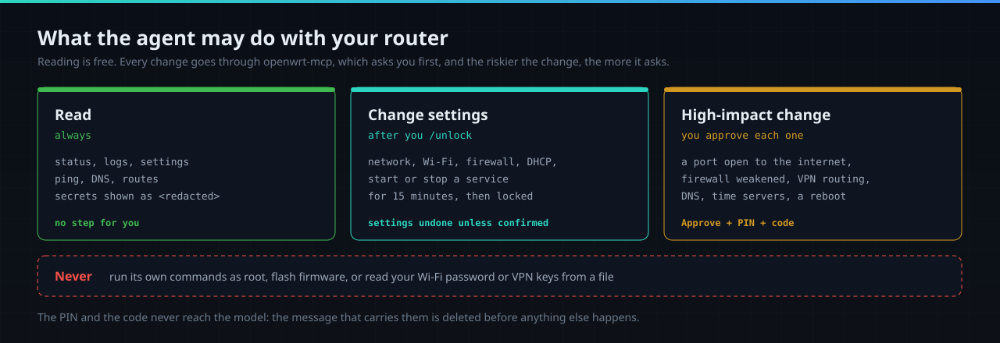

<div align="center">


# hermes-openwrt

[**Hermes Agent**](https://github.com/NousResearch/hermes-agent) packaged to run on the router
itself: an `apk` for OpenWrt 25.12, a signed feed, a LuCI page, and figures measured on real
routers.

[](https://github.com/TAIPANBOX/hermes-openwrt/actions/workflows/ci.yml)


</div>


**Current release**, in the feed since 2026-10-28: `hermes-agent` 0.21.5-r19, `openwrt-mcp`
0.5.0.7-r1, `luci-app-hermes` 0.21.5-r4, `hermes-agent-telegram` 0.21.5-r2. It carries the security
updates of eleven libraries under Hermes. A router set up before 2026-10-22 runs the `wget` line of
[step 1](#install) once more: the feed has a new signing key since then.

## What it does

- **Answers about your network, from your phone.** Ask "why is the internet slow?" in Telegram:
  it pings, checks DNS and reads the router, and answers from what it saw.
- **Watches quietly, if you set it to.** A scheduled check every hour that says nothing unless
  something is wrong.
- **Changes the router only with you.** Settings after you unlock it; the risky changes only
  after you approve each one.

The router runs the agent; a model provider you choose runs the model, free ones included. It has
no browser, so it cannot book, buy or sign in to websites. More: [docs/use.md](docs/use.md).

## Install


You need vanilla OpenWrt 25.12 on aarch64, 1 GB of memory (512 MB fits one conversation), about
350 MB of flash ([or a USB stick](#where-it-installs)), a key for any OpenAI-compatible provider,
and a backup kept off the router. Details: [docs/install-notes.md](docs/install-notes.md).

**1. Trust the feed and install.**

```sh
wget -O /etc/apk/keys/hermes-openwrt.pem \
  https://taipanbox.github.io/hermes-openwrt/hermes-openwrt.pem

echo "https://taipanbox.github.io/hermes-openwrt/25.12/$(cat /etc/apk/arch)/packages.adb" \
  >> /etc/apk/repositories.d/customfeeds.list

apk update && apk add hermes-agent luci-app-hermes
```

On an image without LuCI, add `luci-light`. If apk stops at `Connection aborted`, run the same
line again.

**2. Give it a model and start it.** The service ships switched off.

```sh
printf '%s' 'sk-...' > /etc/hermes-agent/provider.key && chmod 600 /etc/hermes-agent/provider.key
uci set hermes.main.base_url='https://openrouter.ai/api/v1'   # any OpenAI-compatible endpoint
uci set hermes.main.model='openai/gpt-6.1-sol'
uci set hermes.main.enabled=1
uci commit hermes && /etc/init.d/hermes-agent restart
logread -e hermes | tail -n 20
```

Type it in an SSH session on the router: `printf` is a shell builtin, so the key never appears on a
command line another process could read. Or set it in the browser, under **Services -> Hermes Agent
-> Settings**, where the key can be written and never read back. Pick a model with native tool
calling: [which models work](docs/measured.md#which-models-can-actually-drive-it).

**3. Reach it from Telegram** (optional).

```sh
apk add hermes-agent-telegram
printf '%s' '<token from @BotFather>' > /etc/hermes-agent/telegram.token && chmod 600 /etc/hermes-agent/telegram.token
uci set hermes.telegram.enabled=1
uci add_list hermes.telegram.allow_user_id=<your numeric id, from @userinfobot>
uci commit hermes && /etc/init.d/hermes-agent restart
```

The router opens no port and answers only the ids you allow. More: [docs/telegram.md](docs/telegram.md).

**4. Let it change the router** (optional): [below](#letting-it-change-the-router).

<details>
<summary>Upgrading and removing</summary>

```sh
apk update && apk upgrade hermes-agent luci-app-hermes openwrt-mcp && /etc/init.d/hermes-agent restart
```

Add `hermes-agent-telegram` to the upgrade if you installed it. Never install a fixed version with
`apk add hermes-agent=<version>`: that pins it, and later upgrades silently keep the old one.

To remove it: `/etc/init.d/hermes-agent stop`, then
`apk del luci-app-hermes hermes-agent-telegram hermes-agent openwrt-mcp` (with the data on a stick,
`hermes-usb back` first). The data, keys and configuration stay;
[how to remove everything](docs/install-notes.md#removing-it).
</details>

## Letting it change the router



The agent always reads the router. To change it, it needs you:

- **Settings** (network, Wi-Fi, firewall, DHCP, and starting or stopping a service): after you send
  `/unlock` with your PIN or app code in Telegram. The window lasts 15 minutes, and a settings
  change nobody confirms rolls itself back.
- **High-impact changes** (a port opened to the internet, the firewall weakened, VPN or policy
  routing, DNS or the time servers, a reboot): they wait for you even with the window open. The bot
  sends a card, you tap **Approve**, and you send your PIN and the code your phone shows:
  `4821 503917`.

**Why a PIN and a code.** The PIN is something you know; the code comes from your phone and changes
every 30 seconds. A stolen Telegram session has neither, a lost phone lacks the PIN, and the agent,
whatever a web page told it, can approve nothing.

All of this is the default `owner` profile. The `root` profile, an explicit choice that warns at
every start, runs the agent as root with none of these steps.

Set it up once under **Services -> Hermes Agent -> Security**: a PIN, a phone (scan the QR code with
an authenticator app), and what `/unlock` asks for.

<details>
<summary>Show the steps, with pictures</summary>

1. **A PIN**, 4 to 8 digits, typed twice: press *Set PIN*. The router keeps only a salted hash of it.
2. **A phone**: press *Add a phone*. Scan the QR code with an authenticator app, type the six
   digits it shows into *Code from the app*, and press *Check the code and add the phone*. The QR
   code is shown once; do not photograph it or send it anywhere, since whoever has it can make your
   codes.

   

3. **What unlocking asks for**: a PIN, an app code or both, for `/unlock`, and press Save. *Who
   approves* is filled in when only one Telegram user is allowed to talk to the agent.

   

When the table at the top of the page shows *READY*, high-impact changes can be approved from
Telegram:


The pictures come from a demonstration router: the QR code, the secret and the Telegram id in them
are not in use anywhere. The same steps, with more on each: [docs/approval.md](docs/approval.md#set-it-up-once).
</details>

<details>
<summary>What approving looks like in Telegram</summary>


1. The agent answers that the change waits for your approval; nothing has been applied.
2. The bot sends a card: what the change opens, and every setting it adds or changes.
3. Tap **Approve**, or send `/approve` and its five-letter id. The bot repeats the change: that line
   is what will run.
4. Send your PIN, a space, and the six digits your app shows now. The code still works for a minute
   after the app has moved on to the next one.
5. *Approved and applied*. The agent checks the router and confirms the change; a change nobody
   confirms is rolled back after five minutes.

A PIN sent without tapping Approve first is answered with what waits and opens nothing. **Reject**
is one tap. More, including what each answer from the bot means: [docs/approval.md](docs/approval.md).
</details>

<details>
<summary>Over SSH instead, where the QR code is printed in the terminal</summary>

```sh
python3 -c 'import getpass; print(getpass.getpass("PIN: "))' | openwrt-mcp pin set hermes-main
openwrt-mcp mfa enrol hermes-main --pending --qr
openwrt-mcp mfa activate hermes-main <code from the app>
uci set hermes.security.factor=pin+totp    # none, pin, totp or pin+totp
uci commit hermes && /etc/init.d/hermes-agent restart
```

The first line reads the PIN without echoing it, using the python3 the package already depends
on (OpenWrt's BusyBox has no `stty`). Run it in an SSH session with a terminal (`ssh -t`).
</details>

How each part works, and its limits: [docs/approval.md](docs/approval.md), [docs/security.md](docs/security.md).

## Where it installs


On the router's flash by default. To keep the repeated writes off the flash, move the data to a USB
stick with one command after the install (`hermes-usb move /dev/sda1 --format`). With under 450 MB
free, put every package on the stick with OpenWrt's extroot first. Commands and measurements:
[docs/usb.md](docs/usb.md).

## Measured on three routers


Vanilla OpenWrt 25.12.5 on a Flint 2 (a Wi-Fi router), a Brume 2 (a wired gateway) and a Beryl AX
(512 MB, Hermes on a USB stick). Measured on 2026-09-25: a diagnosis of five commands took 18 to
25 s, the gateway held about 180 MB, and six conversations at once were all answered. Whether a model can drive it depends
on native tool calling, not size. Every figure and how it was taken: [docs/measured.md](docs/measured.md).

## Help test it

The most useful reports: a reminder set in plain words, the gateway's memory over several days, web
search with your model, and any other aarch64 router. Open an
[issue](https://github.com/TAIPANBOX/hermes-openwrt/issues/new/choose), and check a log for keys
before you paste it. Security problems go to [SECURITY.md](SECURITY.md).

## How it is built and checked

Hermes 0.21.5 is assembled inside the OpenWrt release it targets, from one pinned upstream commit,
and the feed is signed on a workstation, never in CI. It stays on 0.21.5 because later releases need
Python 3.14 and OpenWrt 25.12 ships 3.13. CI installs the packages into OpenWrt's own rootfs and
checks them there, and teeth scripts plant faults to prove each check catches them:
[docs/build.md](docs/build.md), [docs/checks.md](docs/checks.md), [CONTRIBUTING.md](CONTRIBUTING.md).

## More

| | |
|---|---|
| [docs/use.md](docs/use.md) | what it is for, scheduled jobs, what it will not do |
| [docs/install-notes.md](docs/install-notes.md) | requirements in detail, a way back, removing everything |
| [docs/agent-install.md](docs/agent-install.md) | the install as an agent runs it |
| [docs/approval.md](docs/approval.md) | setting up the PIN and the phone, approving a change |
| [docs/security.md](docs/security.md) | keys, profiles, the unlock, the controls |
| [docs/measured.md](docs/measured.md) | every hardware figure, which models work |
| [docs/usb.md](docs/usb.md) | `hermes-usb` and extroot |
| [docs/providers.md](docs/providers.md) | several providers, a ChatGPT subscription, a model gateway |
| [docs/telegram.md](docs/telegram.md) | the phone, the allowlist, a test chat |
| [docs/build.md](docs/build.md) · [docs/checks.md](docs/checks.md) | how it is built, every gate |
| [CONTRIBUTING.md](CONTRIBUTING.md) · [SECURITY.md](SECURITY.md) | changing it, reporting a vulnerability |
