<div align="center">

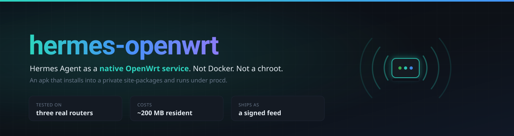

# hermes-openwrt

[**Hermes Agent**](https://github.com/NousResearch/hermes-agent) packaged to run on the router
itself: an `apk` for OpenWrt 25.12, a signed feed, a LuCI page, and figures measured on real
routers rather than in a container.

[](https://github.com/TAIPANBOX/hermes-openwrt/actions/workflows/ci.yml)


</div>

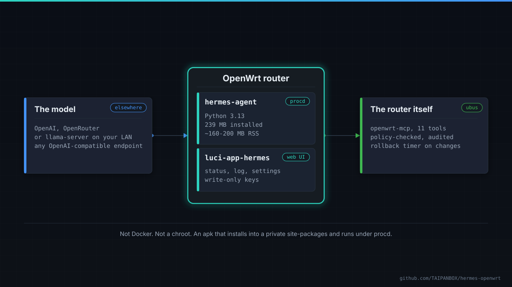

**Current release**, in the feed since 2026-10-09: `hermes-agent` 0.21.5-r14, `openwrt-mcp`
0.5.0.4-r1, `luci-app-hermes` 0.21.5-r3 and `hermes-agent-telegram` 0.21.5-r1.

## What it is, and what it is not

Hermes runs on your router, always on, as an assistant for the network it sits in. The router
runs the agent; a model provider you choose runs the model, and free providers work too. The
package has no browser, so the agent cannot book, buy or sign in to websites. It can still
search the web and read ordinary pages, without a search API key.

| Use | What it looks like | Status |
|---|---|---|
| **The home network, from a phone** | Ask "why is the internet slow?" in Telegram. The agent runs commands on the router and answers from what they print | Measured on the Flint 2 and the Brume 2: a five-command diagnosis in 18 to 25 s; 9 s on a freshly installed Flint 2 with 0.21.5-r9, which lets the agent ping ([measured](docs/measured.md#the-agents-own-ping)) |
| **A watch that speaks only when something is wrong** | Every hour a script collects loss, latency, DNS, memory, flash and temperature. The model reads them in one call and says nothing if all is well | Ran for 19 hours on a Brume 2, one model call per check ([how it stays silent](docs/use.md#scheduled-jobs-in-practice)) |
| **A morning message** | Weather, the exchange rate and one news item at 08:00 | Arrived on time; a small free model skipped the search it was asked to do |
| **An assistant that is always on** | Reminders and lists, set in plain words in a chat | Not measured yet |

If you need an agent that browses, books or signs in, run Hermes on a machine with 2 GB of
memory or more. The router can still serve that agent as a narrow, audited tool provider
through [openwrt-mcp](https://github.com/TAIPANBOX/openwrt-mcp). More: [docs/use.md](docs/use.md).

## Tested on three routers

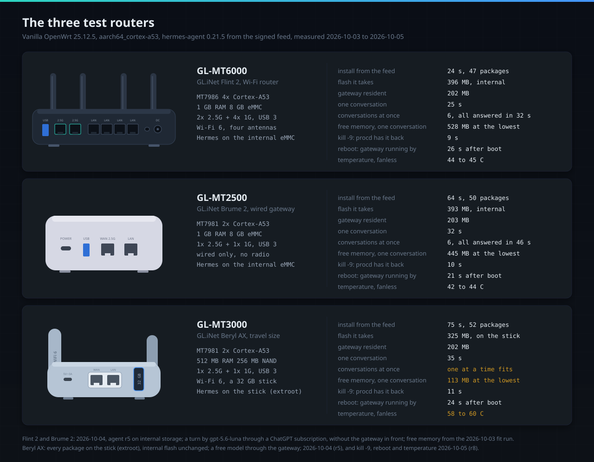

Three GL.iNet routers running **vanilla OpenWrt 25.12.5**, not the vendor firmware. They cover
three shapes of the same job: a Wi-Fi router (Flint 2), a wired gateway (Brume 2), and a 512 MB
travel router that keeps Hermes on a USB stick (Beryl AX). Each card holds every figure for its
router. Before each run the router was cleaned of the package, and afterwards it was put back
as it was. How each figure was taken: [docs/measured.md](docs/measured.md).

## Where it installs: the router's flash or a USB stick

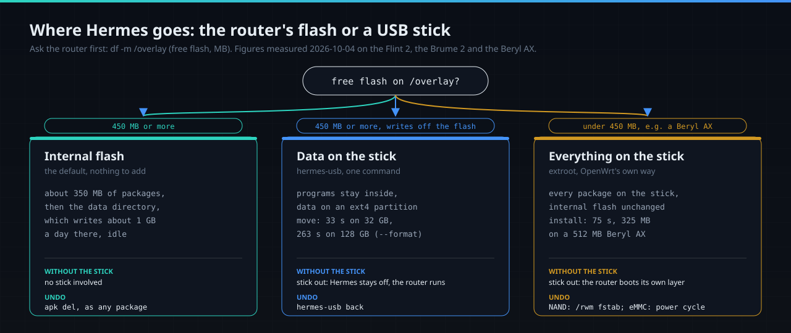

| | When | What it takes | Without the stick | Undo |
|---|---|---|---|---|
| **Internal flash**, the default | 450 MB or more free on `/overlay` | Nothing beyond [Install](#install) | No stick involved | `apk del` |
| **Data on a stick**, `hermes-usb` | The same, when you would rather keep the repeated writes off the router's flash | The USB packages, then one command (below) | Hermes stays off and says why; the router works as usual | `hermes-usb back` |
| **Everything on a stick**, extroot | Under 450 MB free, as on the Beryl AX (256 MB of NAND) | OpenWrt's extroot (format, fstab, copy, one reboot), then [Install](#install) as usual | The router boots its own layer, without Hermes | NAND: remove the two fstab sections under `/rwm` and reboot; eMMC: pull the stick and power-cycle |

To move the data to a stick, after [Install](#install):

```sh
apk update && apk add kmod-usb-storage block-mount kmod-fs-ext4 e2fsprogs
block info                            # the stick's partition: /dev/sda1 here; it can take a few
                                      # seconds to appear after the apk add, so run this again
hermes-usb move /dev/sda1 --format    # erases that partition, makes ext4, moves the data
hermes-usb status
```

Extroot's commands, what each one refuses, and every measurement: [docs/usb.md](docs/usb.md).

## Install

| You need | |
|---|---|
| **Router** | Vanilla OpenWrt 25.12 (not a vendor firmware) on aarch64: `cat /etc/apk/arch` prints `aarch64_cortex-a53` or `aarch64_generic`. Tested on a Flint 2, a Brume 2 and a Beryl AX |
| **Memory** | 1 GB. With 512 MB, one conversation at a time fits, with little to spare |
| **Flash** | About 350 MB for the packages, plus the data directory (37 MB at the first start, and it grows). Short of flash: [use a USB stick](#where-it-installs-the-routers-flash-or-a-usb-stick) |
| **A model** | A key for any OpenAI-compatible provider, free ones included. The service does not start without one |
| **A way back** | A backup kept off the router (`sysupgrade -b /tmp/backup.tar.gz`), and your router's vendor firmware at hand |

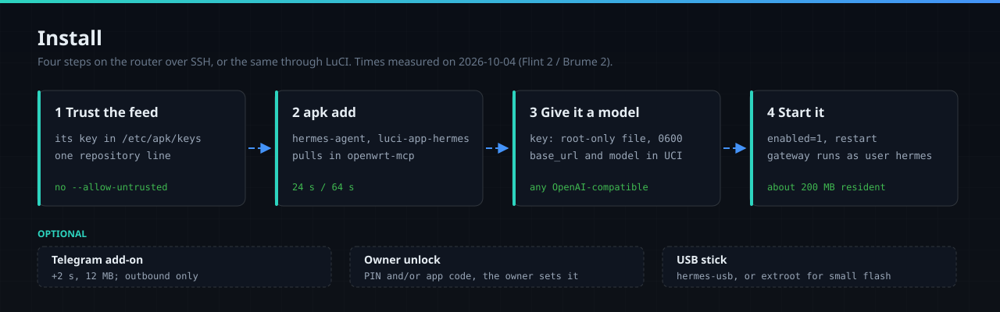

**1. Trust the feed and install.**

```sh
wget -O /etc/apk/keys/hermes-openwrt.pem \
  https://taipanbox.github.io/hermes-openwrt/hermes-openwrt.pem

echo "https://taipanbox.github.io/hermes-openwrt/25.12/$(cat /etc/apk/arch)/packages.adb" \
  >> /etc/apk/repositories.d/customfeeds.list

apk update && apk add hermes-agent luci-app-hermes
```

If apk ends with `N errors;` after `Connection aborted`, a download from OpenWrt's own server
was cut off. Run the same `apk add` again until it ends with `OK:`.

You need no `--allow-untrusted` and no `--force`; that is what signing the feed is for.
`hermes-agent` pulls in `openwrt-mcp` from the same feed and creates the `hermes` account the
agent runs as.

**2. Give it a model and start it.** The service ships switched off.

Type this in an SSH session on the router. `printf` is a shell builtin, so the key never
appears on a command line that another process could read. Sending the same line as
`ssh router "..."` would put it on one.

```sh
printf '%s' 'sk-...' > /etc/hermes-agent/provider.key && chmod 600 /etc/hermes-agent/provider.key
uci set hermes.main.base_url='https://openrouter.ai/api/v1'   # any OpenAI-compatible endpoint
uci set hermes.main.model='openai/gpt-6.1-sol'               # see the note below on models
uci set hermes.main.enabled=1
uci commit hermes && /etc/init.d/hermes-agent restart
logread -e hermes | tail -n 20
```

Pick a strong model. On 2026-10-08, on a Flint 2 and a Brume 2 through Telegram, `gpt-6.1-sol`
through a ChatGPT subscription pinged the gateway and the internet, checked DNS and the ports,
and reported only what it saw. With the same package, `openai/gpt-4o-mini` looped on its memory
tool, skipped the ping and suggested a reboot. OpenRouter bills `openai/gpt-6.1-sol` per token;
through a ChatGPT subscription it costs nothing extra, and you pick it per chat (see below).

You can also do this in the browser, under **Services -> Hermes Agent -> Settings**. The key
goes into a root-only file: the page can write it but never reads it back. Which models can
drive the agent is measured [below](#which-models-can-drive-it).

**3. Reach it from a phone** (optional).

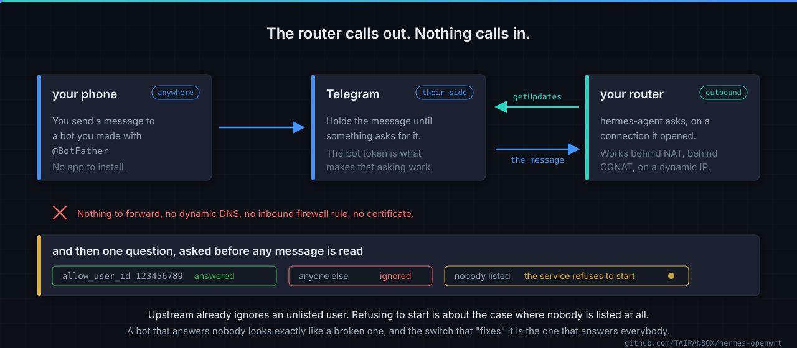

The router opens no port. It polls Telegram over an outbound connection, so it works behind NAT
and CGNAT. Only the numeric user ids you allow get an answer, and with nobody allowed the
service refuses to start rather than quietly answer no one. The token is a root-only file, like
the key.

```sh
apk add hermes-agent-telegram
printf '%s' '<token from @BotFather>' > /etc/hermes-agent/telegram.token
chmod 600 /etc/hermes-agent/telegram.token
uci set hermes.telegram.enabled=1
uci add_list hermes.telegram.allow_user_id=<your numeric id, from @userinfobot>
uci commit hermes && /etc/init.d/hermes-agent restart
```

In a new chat, the first reply may be Hermes's own onboarding question, which offers to build a
short profile of you. Answer it, or send your message again. More, including what a first test
chat looks like: [docs/telegram.md](docs/telegram.md).

**4. Let it change the router** (optional). In the default `owner` profile the agent reads the
router freely but changes it only after you unlock it with a second factor. Until you set a
factor, nothing can change the router through the agent. Set one under **Services -> Hermes
Agent -> Security**, or over SSH, where the QR code is printed in the terminal:

```sh
python3 -c 'import getpass; print(getpass.getpass("PIN: "))' | openwrt-mcp pin set hermes-main
openwrt-mcp mfa enrol hermes-main --pending --qr
openwrt-mcp mfa activate hermes-main <code from the app>
uci set hermes.security.factor=pin+totp    # none, pin, totp or pin+totp
uci commit hermes && /etc/init.d/hermes-agent restart
```

The first line reads the PIN without echoing it, using the python3 the package already depends
on (OpenWrt's BusyBox has no `stty`). Run it in an SSH session with a terminal (`ssh -t`).

To unlock, send `/unlock` and the PIN as one message in the private chat, for example
`/unlock 4821`. That opens a 15-minute window. With `pin+totp`, send both: `/unlock 4821 503917`.
The digits alone work too. `/unlock` on its own opens nothing, and the bot replies with what to
send. On the Security page the PIN and the factor each have their own Save, and a PIN unlocks
nothing until the factor asks for it.

During the window the agent can change network, Wi-Fi, firewall, DHCP and system settings (and
install official packages, if you turned that on). It cannot run its own commands as root:
[how it keeps the router yours](#how-it-keeps-the-router-yours).

**Upgrading.** Run `apk update && apk upgrade hermes-agent luci-app-hermes openwrt-mcp` (plus
`hermes-agent-telegram` if you added it), then `/etc/init.d/hermes-agent restart`. An upgrade
does not restart a running gateway, and it leaves the start at boot as you set it. Do not
install a fixed version with `apk add hermes-agent=<version>`: that pins it in
`/etc/apk/world`, and later upgrades silently keep the old one.

**Removing it.** If `hermes-usb status` says the data is on a stick, run `hermes-usb back` first.

```sh
/etc/init.d/hermes-agent stop
apk del luci-app-hermes hermes-agent-telegram hermes-agent openwrt-mcp
```

This leaves the data, the keys, the configuration and the `hermes` account in place, on
purpose. How to remove all of it: [docs/install-notes.md](docs/install-notes.md#removing-it).

For an agent doing the install: [docs/agent-install.md](docs/agent-install.md) is the same
procedure, written as checks to run and the output each one must show.

## How it keeps the router yours

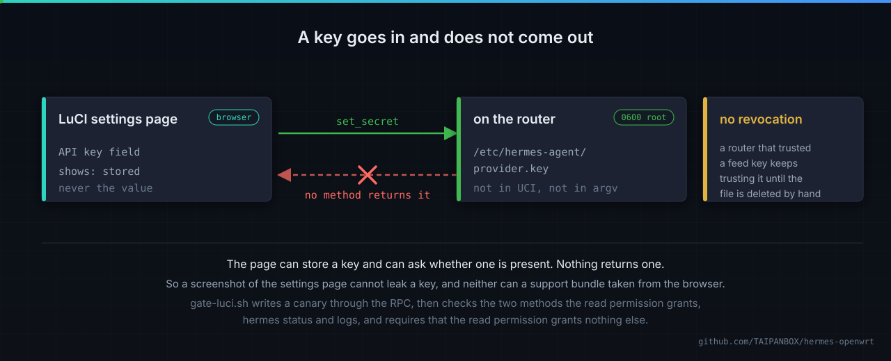

Keys live in root-only files under `/etc/hermes-agent`. The LuCI page can write a key and ask
whether one exists, but no page and no call ever returns one. Keys also stay out of command
lines, UCI and procd's service table.

| profile | runs as | the router |
|---|---|---|
| `owner` (default) | `hermes`, unprivileged, in a sandbox | read through openwrt-mcp; changed only through it, after an unlock |
| `assistant` | `hermes`, in a sandbox, with no terminal, code or file tools | only through an MCP server you set up |
| `root` | root, with a warning at every start | directly, with no unlock |

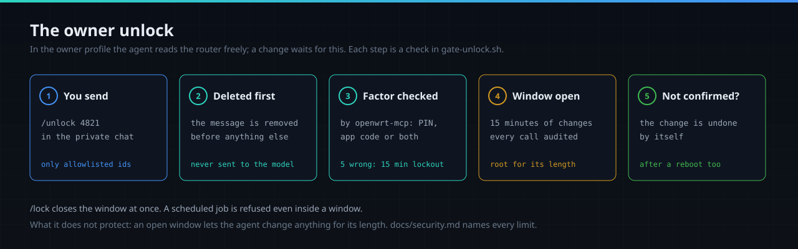

The owner unlocks from the private Telegram chat with a PIN, a code from an authenticator app,
or both. The unlock message is deleted before anything else happens, and it never reaches the
model or a log. Five wrong tries block unlocking for fifteen minutes.

The `/unlock` itself is your consent. After a settings change, the agent checks that the router
still answers and then confirms the change. A settings change nobody confirms (the router lost
its connection, or the agent never got that far) rolls itself back, after about 90 seconds by
default, and after a reboot too. Starting or stopping a service, and installing a package, are
not rolled back.

In a window the agent can change settings, the VPN and services. It cannot run a command over
ubus, write a file, flash firmware or reboot, and openwrt-mcp refuses the settings it knows run
code, such as a firewall include. It installs packages only if you opt in on the Security page
("Let the agent install packages from the official OpenWrt feed", or
`hermes.security.packages=official`). Even then it installs only from the official OpenWrt feed
and only in a window, and the agent is told to do a dry run first and tell you what it would
install; this needs openwrt-mcp 0.5.0.4 or later.

The service's terminal, file and search tools run in a sandbox, OpenWrt's ujail: the router's
configuration files, the overlay and other services' runtime files are simply not there, so none
of them can read a Wi-Fi password or a VPN key from a file. Ping, DNS, routes and the agent's own
data work as before. The agent reads every UCI config through openwrt-mcp instead, Wi-Fi and
network included, so it can set up a guest network or check a package it installed, and it can
see which services are running. openwrt-mcp answers Wi-Fi keys, WireGuard private keys and
passwords as `<redacted>`, recognising them by option name, and the package grants these wider
reads only when openwrt-mcp reports that it redacts. A secret kept under an option whose name
does not say so (a token inside a DDNS update URL, say) is read as it is. Everything, with the
limits named: [docs/security.md](docs/security.md).

## Measured on hardware

The first full measurement ran on 2026-09-25 on the Flint 2 and the Brume 2 with
**Hermes 0.21.5**. A conversation there was a real diagnosis: `openai/gpt-4o-mini` running five
commands through the terminal tool.

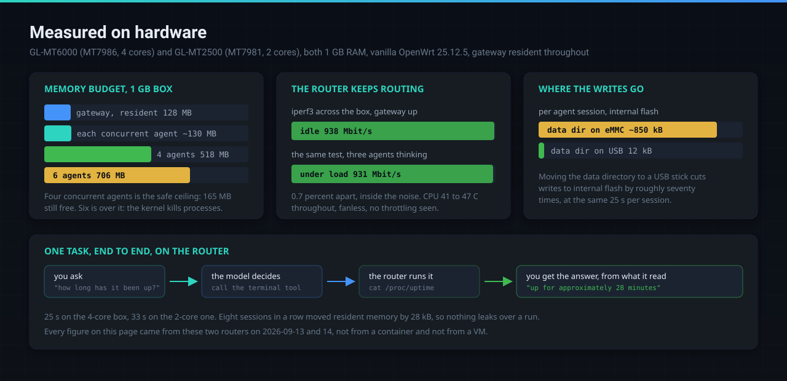

| | GL-MT6000 (Flint 2) | GL-MT2500 (Brume 2) |
|---|---|---|
| SoC | MT7986, 4x Cortex-A53 | MT7981, 2x Cortex-A53 |
| RAM / free flash | 1 GB / 6.8 GB | 1 GB / 6.8 GB |
| `apk add hermes-agent luci-app-hermes`, from nothing | 17 s, 46 packages | 48 s, 45 packages |
| package tree (`/usr/lib` and `/usr/share/hermes-agent`) | 239 MB | 239 MB |
| `hermes --version`, cold | 2 s | 3 s |
| gateway resident | 179 MB | 178 MB |
| one conversation, end to end | 18 s | 25 s |
| six conversations at once | 25 s, all answered | 30 s, all answered |
| all of Hermes at six, memory | 361 MB | 379 MB |
| temperature, fanless | 51 to 52 C | 45 to 47 C |

### Re-run on the published release, 2026-10-04

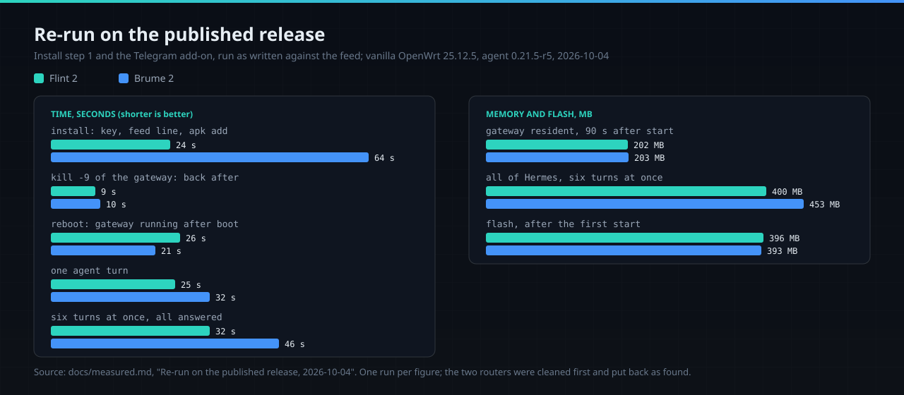

Step 1 of [Install](#install) and the Telegram add-on, run exactly as written against the
published feed (agent 0.21.5-r5), with `gpt-5.6-luna` through a ChatGPT subscription. The router
cards above carry the same figures; the full table is in
[docs/measured.md](docs/measured.md#re-run-on-the-published-release-2026-10-04).

### How many agents fit alongside your other services

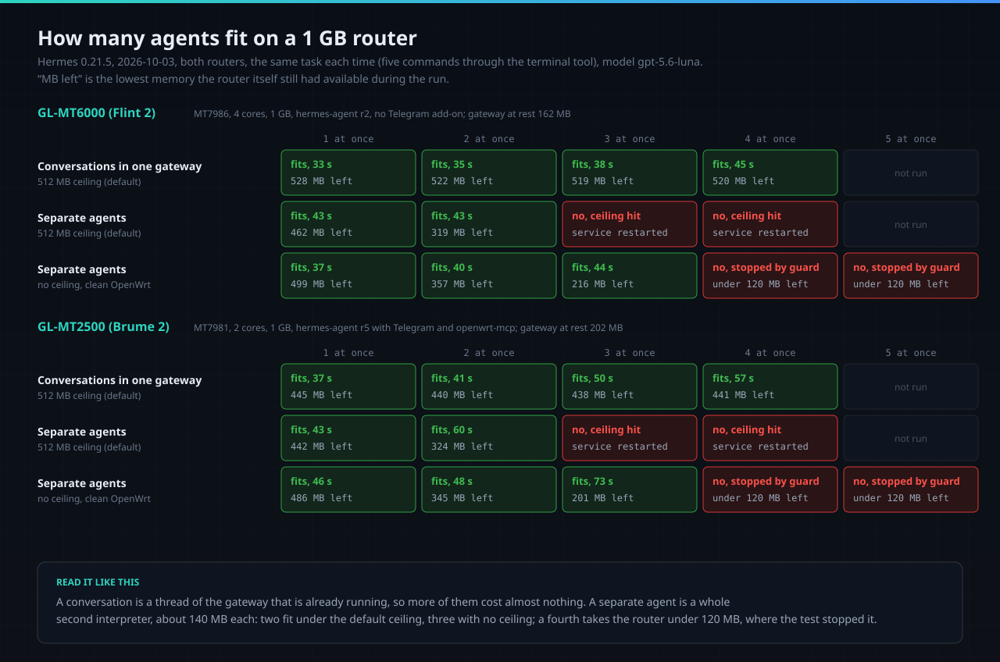

- **Conversations in one gateway** (how Telegram serves several chats) are threads of a process
  that is already running. One to four at once kept all of Hermes flat at 388 MB on the Flint 2
  and 445 MB on the Brume 2.
- **Separate agents** each need their own Python interpreter, about 140 MB. Two fit under the
  default 512 MB ceiling; a third fills it, and the service restarts.
- **With the ceiling lifted**, three fit on clean OpenWrt, leaving 201 to 216 MB.

So plan on conversations, not separate agents. In a separate run on 2026-09-25, conversations
ran while the routers did their own job. The Flint 2's household traffic moved only as much as
the line itself varies, with no loss. On the Brume 2, a WireGuard tunnel carrying 574 Mbit/s
fell to 414 and 404 Mbit/s with one and three conversations, and only to 439 Mbit/s at nice 10
(one run per step), which is why the service runs at nice 10. Details:
[docs/measured.md](docs/measured.md).

### Which models can drive it

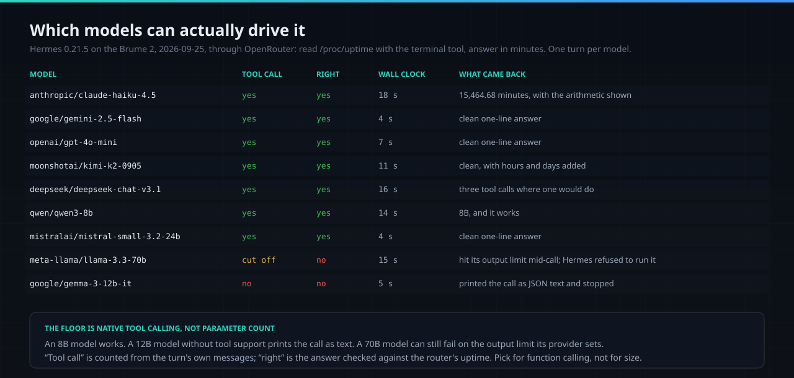

The same task for each model, one turn on the Brume 2 through OpenRouter on 2026-09-25: read
`/proc/uptime` with the terminal tool and give the uptime in minutes.

| Model | Called the tool | Right | Wall clock | Note |
|---|---|---|---|---|
| `anthropic/claude-haiku-4.5` | yes | yes | 18 s | |
| `google/gemini-2.5-flash` | yes | yes | 4 s | |
| `openai/gpt-4o-mini` | yes | yes | 7 s | |
| `moonshotai/kimi-k2-0905` | yes | yes | 11 s | |
| `deepseek/deepseek-chat-v3.1` | yes | yes | 16 s | three calls where one would do |
| `qwen/qwen3-8b` | yes | yes | 14 s | 8B, and it works |
| `mistralai/mistral-small-3.2-24b-instruct` | yes | yes | 4 s | |
| `meta-llama/llama-3.3-70b-instruct` | cut off | no | 15 s | ran out of output tokens mid-call; Hermes refused to run the half-written command |
| `google/gemma-3-12b-it` | **no** | no | 5 s | printed the call as JSON text |

What decides it is native tool calling, not size: an 8B model works, and a 12B model without
tool support does not. Choose a model for its function calling.

Changing the router asks more of a model than one tool call. On 2026-10-08, on a Brume 2 and a
Flint 2 through Telegram and openwrt-mcp, `gpt-6.1-sol` through a ChatGPT subscription ran the
diagnosis correctly, while `gpt-4o-mini` looped on its memory tool and made a wrong firewall
change. Sign in to a subscription with `hermes-login chatgpt` and pick it per chat with
`/model gpt-6.1-sol --provider openai-codex` ([docs/providers.md](docs/providers.md)).

## How it is built

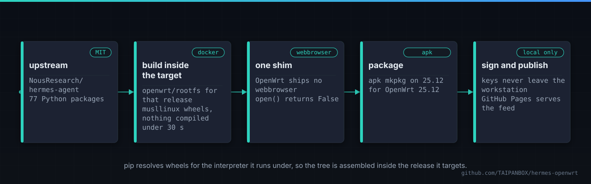

Hermes 0.21.5 is assembled, not ported. pip on OpenWrt resolves musllinux wheels and every
wheel Hermes needs exists, so the package is built inside the OpenWrt release it targets: one
pinned upstream commit, every library at the version upstream locks, and one shim
(`webbrowser`). [docs/build.md](docs/build.md).

Upstream has moved on to 0.22, but every release after 0.21.5 needs Python 3.14 for its
dependencies, and OpenWrt 25.12.5 ships Python 3.13. So the package stays on 0.21.5 for now. A
daily check opens one issue when upstream's latest release is newer than the packaged one.

### The signed feed

The index and every package are signed with an EC key through `apk adbsign`. Signing happens on
a workstation, never in CI, because a router that trusts the key keeps trusting anything it
signs.

## What it will not do

- **Run the model on the router.** A router CPU would spend minutes on the agent's system
  prompt alone, so the model runs elsewhere.
- **Fit a small router.** It takes about 400 MB of flash and 200 MB of RAM before doing any
  work. 512 MB holds one conversation at a time, with the packages on a stick (the Beryl AX
  above). Below that, run openwrt-mcp on the router (4 MB of flash, 7.4 MB of memory, measured)
  and keep Hermes on another machine.
- **Browse, see or draw.** The browser, vision, image generation and the wake-word stack are not
  packaged. `ffmpeg` is, for voice messages.

Several providers at once, a ChatGPT subscription next to a key, `/model` per chat:
[docs/providers.md](docs/providers.md).

## Testing it for us

The most useful reports cover what has not been measured yet:

1. **A reminder set in plain words in a chat**, and whether it arrives on time.
2. **The gateway's memory over days.** The longest run so far lasted 19 hours, and over its
   last 14.5 the gateway grew from 204 to 215 MB: too short to tell a leak from warming up.
   That figure is the gateway's own resident memory; to record it, run this every hour or so:
   `grep VmRSS /proc/$(pgrep -o -f '[m]ain.py gateway')/status`.
3. **Web search with the model you use.** Search works on a router (see
   [the re-run](docs/measured.md#re-run-on-the-published-release-2026-10-04)), but whether a
   model reaches for it unasked depends on the model.
4. **Any aarch64 router other than the Flint 2, Brume 2 and Beryl AX**, with its numbers.

Report what happened in an [issue](https://github.com/TAIPANBOX/hermes-openwrt/issues/new/choose);
the template asks for the router, the versions and the log. Before you paste a log, check it for
keys and tokens. The package keeps them out of its own log lines, but a model's reply or a
command's output can contain anything. Report a security problem through
[SECURITY.md](SECURITY.md), not in an issue.

To change the code yourself, [CONTRIBUTING.md](CONTRIBUTING.md) explains how to build what CI
builds, which checks cover which part, and what a pull request has to pass.

## What is checked, and how

Every gate that tests the product installs the packages into OpenWrt's own published rootfs and
asks the running system, on an arm64 runner in CI (the feed's gate runs when the feed is
published). `gate-apk-owner.sh` reads the built archives, and the gates that check the
repository itself run on a plain runner. Teeth scripts plant faults in the product and require a
check to catch each one.

| gate | covers |
|---|---|
| `gate-package.sh` | install, start, the key out of sight, upgrade, clean removal |
| `gate-runtime.sh` | the gateway against the installed upstream: models, providers, profiles, limits |
| `gate-luci.sh` | the web page: write-only keys, the narrow read permission, the Security page |
| `gate-unlock.sh` | the owner unlock end to end, from Telegram and from LuCI |
| `gate-usb.sh` | `hermes-usb` with real sticks made of loop devices |
| `gate-telegram.sh`, `gate-upstream.sh`, `gate-feed.sh` | the add-on, the pinned upstream, the signed feed |
| `gate-upstream-watch.sh` | the daily check that opens one issue when upstream tags a newer release |
| `gate-apk-owner.sh`, `gate-relabel.sh` | every file in every package is root's; the `aarch64_cortex-a53` package differs from the generic one only in its label |
| `gate-figures.sh` | these figures drawn from their data; every picture, link and anchor resolves |
| `gate-named-routers.sh`, `gate-scenarios-bound.sh` | no router but the three test routers is named; every scenario names a real check, and every check has a scenario |

What each check proves, one by one: [docs/checks.md](docs/checks.md).

## More

| | |
|---|---|
| [docs/use.md](docs/use.md) | what it is for, scheduled jobs, what it will not do |
| [docs/install-notes.md](docs/install-notes.md) | requirements in detail, a way back, removing everything |
| [docs/agent-install.md](docs/agent-install.md) | the install as an agent runs it |
| [docs/measured.md](docs/measured.md) | every hardware figure |
| [docs/usb.md](docs/usb.md) | `hermes-usb` and extroot |
| [docs/security.md](docs/security.md) | keys, profiles, the unlock, the controls |
| [docs/providers.md](docs/providers.md) | several providers, a ChatGPT subscription, a model gateway |
| [docs/telegram.md](docs/telegram.md) | the phone, the allowlist, a test chat |
| [docs/build.md](docs/build.md) | how it is built, the feed, status |
| [docs/checks.md](docs/checks.md) | every gate and its teeth |
| [CONTRIBUTING.md](CONTRIBUTING.md) · [SECURITY.md](SECURITY.md) | changing it, reporting a vulnerability |
