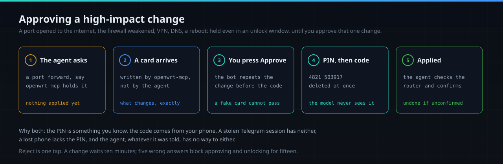
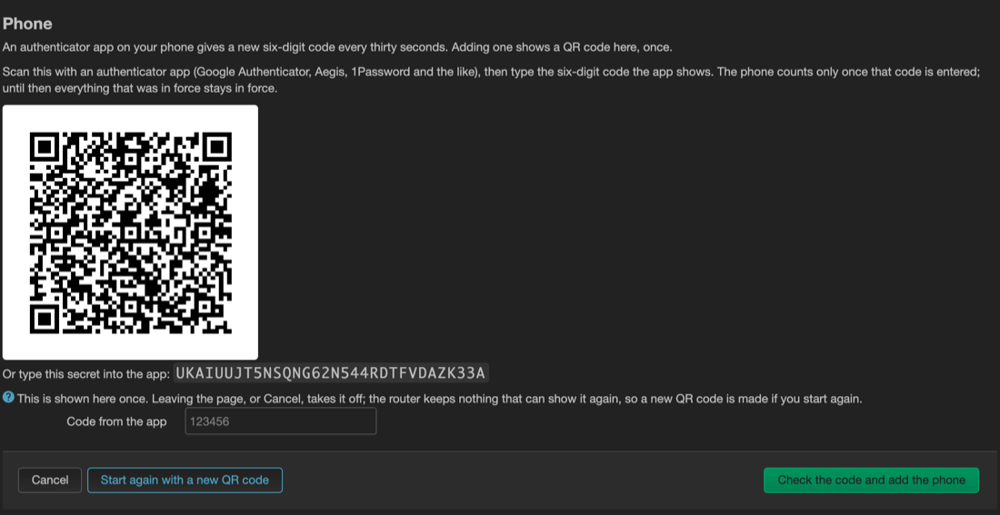
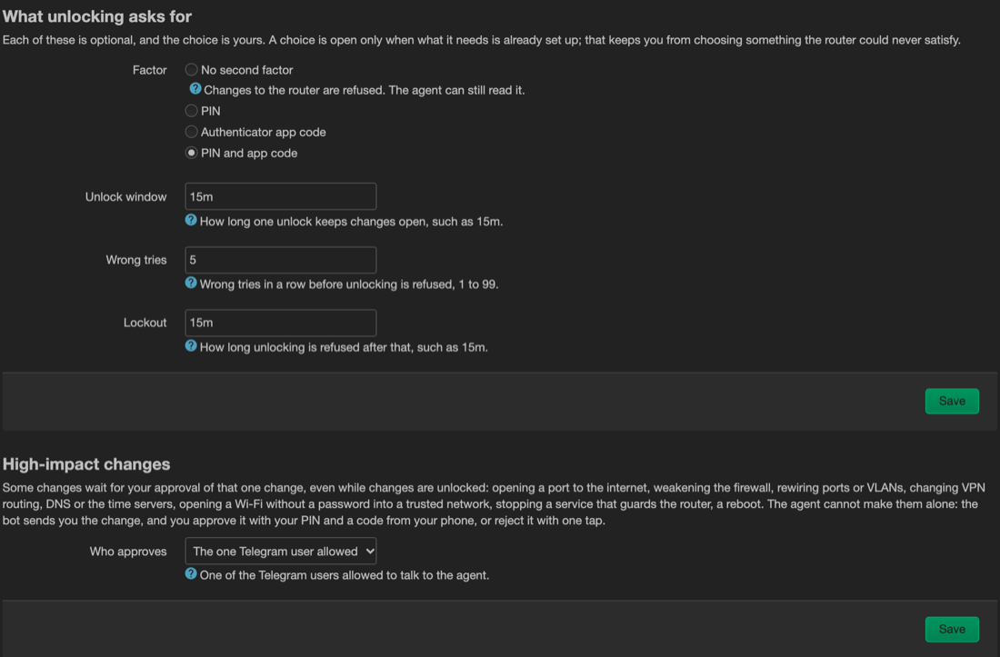
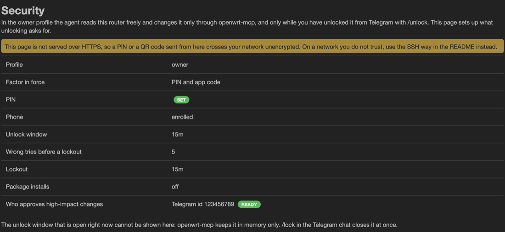

# Approving a high-impact change

The agent changes the router only after you unlock it with `/unlock`. A few changes go further:
even with changes unlocked, the agent cannot make them. It can only ask, and you approve that one
change from Telegram with your PIN and a code from your phone. This page shows how to set that up
once, what approving looks like, and why it takes both.



Which changes are held: a port opened to the internet, the firewall weakened, the router's ports or
VLANs rewired, VPN or policy routing changed, who answers DNS changed, the time servers changed, a
Wi-Fi without a password put into a trusted network, a service that guards the router stopped, and
a reboot. The full list, and what it does not cover: [security.md](security.md#high-impact-changes-wait-for-your-approval).

## Why a PIN and a code, both

**The agent can be talked into things.** It reads web pages, logs and messages, and any of them can
carry instructions written to steer it; models also simply get things wrong. Most settings are safe
to leave to it, because a change nobody confirms rolls itself back. Opening a port to the internet
is different: while it stood, anything on the internet could reach in, and a rollback does not undo
that. So such a change is never the agent's to make.

**What you approve is what runs.** The card is written by openwrt-mcp from its own record of the
change, not by the agent. When you tap Approve, the bot repeats that record before it asks for
anything, so a message the agent writes to look like a card cannot be approved by mistake. The
change runs exactly as held, against a hash of the card you were sent.

**Two factors of different kinds.** The PIN is something you know; the code comes from something you
hold, your phone, and changes every 30 seconds. Someone who took over your Telegram session has
neither. Someone with your unlocked phone has the codes but not the PIN. Someone who once saw your
PIN lacks a code, and a code works only once.

**Neither reaches the model.** Your message with the PIN and the code is deleted from the chat
first, before anything else happens, and is never shown to the model or written to a log. The agent
has no key that could approve: approvals go through a client of yours whose token only the bot
holds.

What it costs you is one tap and one message, for changes that should be rare.

## Set it up once

It takes about two minutes, in the router's web interface under
**Services -> Hermes Agent -> Security**. The pictures below come from a demonstration router; the
QR code and the secret in them are not in use anywhere.

1. **A PIN**, 4 to 8 digits, typed twice, and press *Set PIN*. The router keeps only a salted hash
   of it.
2. **A phone.** Press *Add a phone*. The page shows a QR code, once:

   

   Scan it with an authenticator app: the iPhone's Passwords app, Google Authenticator, Aegis or
   1Password all work. On an iPhone the camera opens Passwords, which asks which entry to keep the
   code in; make one, say `Flint 2`, and the code appears in it as *Verification Code*. Type the six
   digits the app shows into *Code from the app* and press *Check the code and add the phone*. Do
   not photograph the QR code or send it anywhere: whoever has it can make your codes.
3. **What unlocking asks for**: a PIN, an app code or both, for `/unlock`, and press Save. Below it,
   *Who approves* is filled in when only one Telegram user is allowed to talk to the agent.

   

Approving always asks for both the PIN and a code, whatever `/unlock` asks for. It switches on once
both exist and Telegram is set up, and the table at the top of the page says so:



<details>
<summary>The page shows "Unable to load Lua runtime", or you cannot log in</summary>

The router image has no LuCI of its own; `luci-app-hermes` brings in only `luci-base`. Install it:

```sh
apk add luci-light
```

LuCI logs in as `root` with the router's own password. A router set up only with SSH keys may
never have had one: set it with `passwd` in an SSH session.
</details>

<details>
<summary>Over SSH instead of the web page</summary>

```sh
python3 -c 'import getpass; print(getpass.getpass("PIN: "))' | openwrt-mcp pin set hermes-main
openwrt-mcp mfa enrol hermes-main --pending --qr      # prints the QR code in the terminal
openwrt-mcp mfa activate hermes-main <code from the app>
uci set hermes.security.factor=pin+totp               # none, pin, totp or pin+totp
uci commit hermes && /etc/init.d/hermes-agent restart
```

Run it in an SSH session with a terminal (`ssh -t`), so the PIN is read without echoing.
</details>

## Approving a change


1. You ask the agent for something that is held, a port forward say. It answers that the change
   waits for your approval; nothing has been applied.
2. The bot sends a card: what the change opens, and every setting it adds or changes.
3. Tap **Approve** under the card, or send `/approve` and its five-letter id. The bot repeats the
   change. Read that line: it is what will run.
4. Send **your PIN, a space, and the six digits your app shows now**, as one message:
   `4821 503917`. The code still works for a minute after the app has moved on to the next one, so
   there is time to type it.
5. The bot answers *Approved and applied*. The agent checks the router and confirms the change; a
   change nobody confirms is rolled back after five minutes.

**Reject** is one tap, or `/reject` and the id. `/lock` rejects every change still waiting. A
change waits ten minutes, and then the agent has to ask again.

## When it does not go through

| The bot says | What happened | What to do |
|---|---|---|
| *That was not used: a change waits for your approval* | You sent the PIN without tapping Approve first. Nothing was tried or counted | Tap Approve, then send the PIN and a code |
| *Refused. Nothing was approved.* | The PIN or the code was wrong, or the code was too old | Tap Approve again and send the PIN with a fresh code. Five wrong answers in a row block approving and unlocking for fifteen minutes |
| *Changes are open until ...* | That was an `/unlock`: it opens the window, and approves nothing | Tap Approve under the card |
| *This change is no longer waiting* | The card expired or was decided | Ask the agent again |

Lost the phone? Add another one on the Security page; it replaces the old one as soon as its first
code is accepted.
