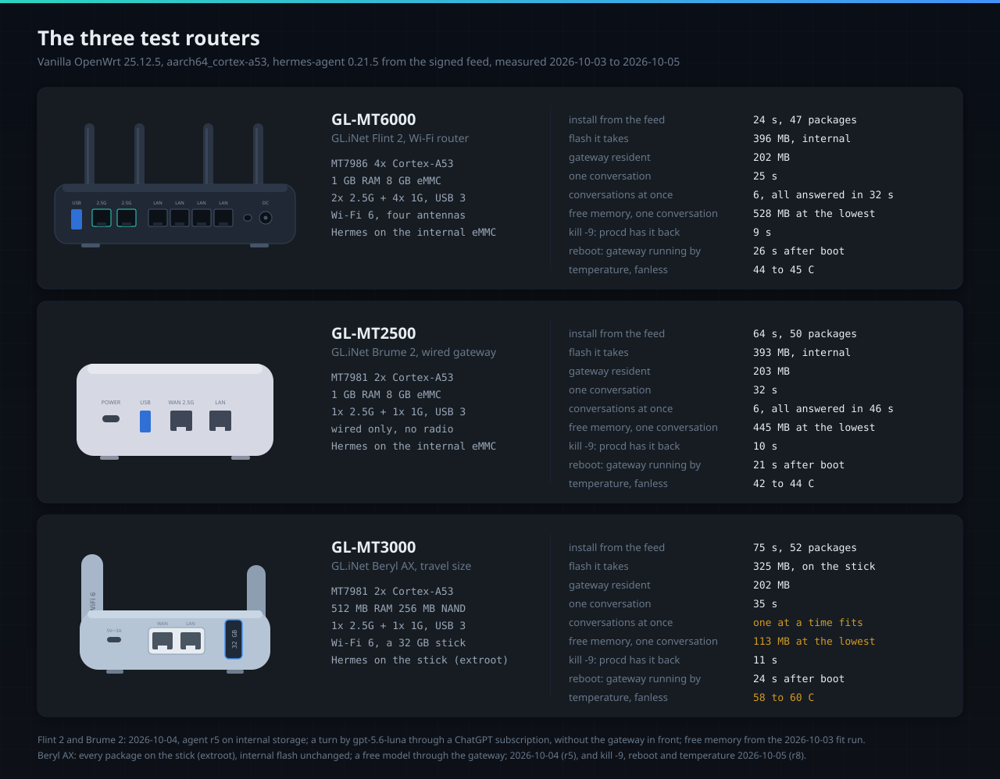
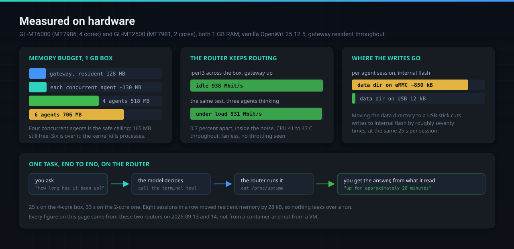
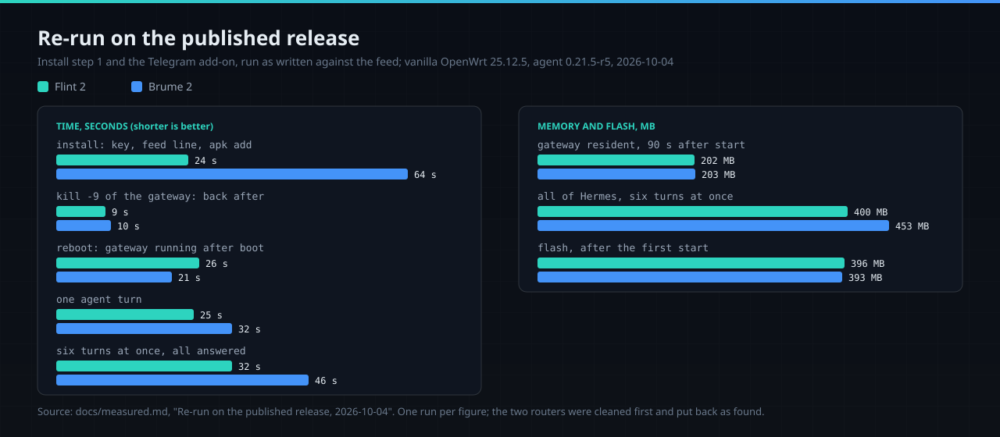
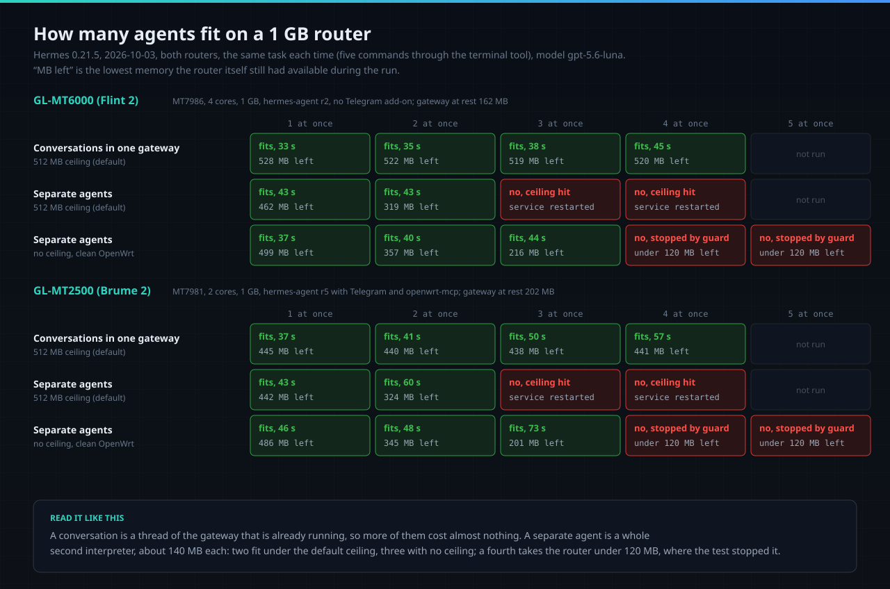
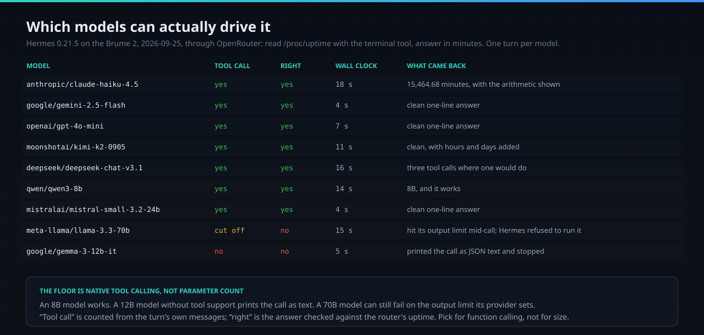

# Measured on hardware

Every figure in this section was measured on two routers with **Hermes 0.21.5**, the
version the package carries, on 2026-09-25 unless a subsection gives its own date: not in a
container and not on a VM.

Both are GL.iNet hardware running **vanilla OpenWrt 25.12.5**, not the vendor firmware
they ship with. They are the two routers the measurements in this section come from, chosen
as two form factors doing the same job (a Beryl AX, the third test router, is the case of a
router with 512 MB and little flash, under [Hermes on a USB stick](usb.md#hermes-on-a-usb-stick)): the Flint 2 is a Wi-Fi 6 router with four cores and six
ports, and the Brume 2 is a wired-only gateway with two cores, closer to what a small
always-on box looks like. Before each run the router was cleaned of every trace of the
package, Python and ffmpeg included, and put back exactly as it was afterwards.

| | GL-MT6000 (Flint 2) | GL-MT2500 (Brume 2) |
|---|---|---|
| SoC | MT7986, 4x Cortex-A53 | MT7981, 2x Cortex-A53 |
| RAM / free flash | 1 GB / 6.8 GB | 1 GB / 6.8 GB |
| `apk add hermes-agent luci-app-hermes`, from nothing | 17 s, 46 packages | 48 s, 45 packages |
| package tree (`/usr/lib` and `/usr/share/hermes-agent`) | 239 MB | 239 MB |
| `hermes --version`, cold | 2 s | 3 s |
| gateway resident | 179 MB | 178 MB |
| one conversation, end to end | 18 s | 25 s |
| six conversations at once | 25 s, all answered | 30 s, all answered |
| all of Hermes at six, memory | 361 MB | 379 MB |
| temperature, fanless | 51 to 52 C | 45 to 47 C |

A conversation here is a real diagnosis: the model (`openai/gpt-4o-mini` on OpenRouter)
runs five commands through the terminal tool and answers from what they printed. The
wall clock is mostly the model's own time.

## The agent's own ping

On 2026-10-08 a Flint 2 was cleaned of every trace of the package and Hermes installed again
from the feed, 0.21.5-r8, by [the agent runbook](agent-install.md). A one-off job asked the
gateway for the same five-command diagnosis: every `ping` it ran answered "permission denied
(are you root?)". BusyBox's ping opens a raw socket, which only root may, and the agent runs as
`hermes` since 0.21.5-r3; the table above was measured with r1, when it still ran as root.
From r9 the package depends on iputils-ping, whose `/usr/bin/ping` is setuid root and comes
first on the service's PATH. With it the same job ran as `hermes`, pinged 1.1.1.1 (10.1 ms
average) and the gateway (0.38 ms) with no loss, and answered in 9 s: two model calls of
`openai/gpt-4o-mini` on OpenRouter, five commands.

## Thread stacks

On 2026-11-22 a Beryl AX with OpenWrt 25.12.6 and 0.21.5-r25 could not finish a single turn that
needed a tool. Asked "Run uptime and tell me the load average." through an Anthropic provider, the
agent died with SIGSEGV (exit 139) as the first answer came back, in a one-shot chat and in a
scheduled job, where it took the whole gateway down until procd restarted it. Nothing said why:
no Python traceback, no kernel line, no core. A turn with no tool answered.

The cause is musl's default thread stack. musl gives a thread 128 KiB unless the program asks for
more, and the router's CPython 3.13 does not ask; glibc gives a thread the size of `ulimit -s`, 8 MiB,
and that is what upstream Hermes is built and tested with. Upstream runs each model call and each
tool in a thread of its own, and the tool turn on Anthropic's wire needs more than 128 KiB there.
`faulthandler` stays silent because its emergency stack belongs to the main thread.

From 0.21.5-r26 the launcher runs upstream's entry point through `/usr/lib/hermes-agent/hermes-start`,
which sets a 4 MiB stack for every thread before any of upstream's code runs, and then runs
`hermes_cli/main.py` exactly as before, so its command line is unchanged. The CLI, the gateway and
every scheduled job start through that launcher.

Measured with OpenWrt 25.12.6's own CPython 3.13.18 (musl) on x86_64, and on aarch64_cortex-a53, the
Beryl AX's architecture, under qemu-user, with r25's own payload and a stand-in for Anthropic's Messages
API on loopback, so no model was paid for. Both architectures gave the same column for the turn:

| Thread stack | Tool turn | Data nested 200000 deep, in a thread (x86_64) |
|---|---|---|
| 128 KiB (musl's default, r25) | SIGSEGV | SIGSEGV |
| 256 KiB | SIGSEGV | SIGSEGV |
| 320 KiB | answered | SIGSEGV |
| 1 MiB | answered | SIGSEGV for `json.loads`, `json.dumps` and `repr`; RecursionError for `pickle` |
| 1.66 MiB | answered | RecursionError for all four |
| **4 MiB (r26)** | answered | RecursionError for all four |

The second column is why the size is not the 320 KiB the turn alone needs. A page the agent fetches,
or a tool's output, can hold JSON nested far deeper than anything sensible; CPython's own recursion
guard then refuses that one call with RecursionError, but only if the thread has the room the guard
was sized for on glibc. Below 1.66 MiB on x86_64 and 1.75 MiB on aarch64 (`json.loads`, `json.dumps`,
`repr` and `pickle` of a list 200000 deep) the process died instead. Such input arrives in a thread
already as deep as the turn, so on aarch64 the two together come to about 2.1 MiB, and 4 MiB is the
smallest power of two above that. A stack is reserved address space, not memory: the peak
resident size of the tool turn was 145.7, 146.3 and 148.7 MB at 1, 4 and 8 MiB, a run-to-run
difference, while the virtual size grew by the reservation of its seven or eight threads.

On the Beryl AX itself, the same day, with r25 installed and r26's launcher and `hermes-start` put over
it for the run (then put back, checksummed equal):

| On the Beryl AX, OpenWrt 25.12.6 | r25 | r26 |
|---|---|---|
| the stand-in turn, `Run uptime and tell me the load average.` | SIGSEGV after 33 s | answered in 29 s, `uptime` ran |
| a real turn, one-shot chat: show the WAN address, ping the gateway and 1.1.1.1 three times each | SIGSEGV | answered in 52 s: 3 model calls, 2 tool turns, both pings 3 of 3 |
| the same turn as a scheduled job, in the gateway | the gateway went down | answered: 3 model calls, 2 tool turns, the gateway ran on |

The real turns used `claude-haiku-5-5` through an Anthropic provider section: six calls, 1 456 tokens out.
The processor stayed between 57.3 and 58.1 C.

## Anthropic as the main provider

On 2026-11-22 a Beryl AX with 0.21.5-r26 could not start with `hermes.main.base_url` at
`https://api.anthropic.com/v1`, `hermes.main.model` `claude-haiku-5-5` and a key file with an
Anthropic key: the gateway's start was refused, procd retried six times in six seconds and
stopped, and the log said only `startup refused (upstream provider, endpoint, model or credential
conflicts with UCI)`. The same address and key as a further provider section (`hermes.claude`)
had always worked.

The cause is two places that disagree about the protocol. The bridge wrote `api_mode:
chat_completions` for every endpoint that is not OpenAI's, and the preflight required that. Upstream
speaks Anthropic's native Messages protocol to `api.anthropic.com` whatever a config says
(`hermes_cli/providers.py` `host_mandated_api_mode`, by exact host name), so the resolver answered
`anthropic_messages` for the main model and the preflight saw a transport UCI never chose. A provider
section names no mode and so never met the preflight's rule. From r27 the bridge writes
`anthropic_messages` for that host, found by upstream's own host test, and the preflight requires the
same; a look-alike host name keeps chat completions, and on Anthropic's own host a route left on chat
completions is still refused. The main key and a provider section's key stay apart.

Measured on the Beryl AX (OpenWrt 25.12.6, the owner profile, 0.21.5-r26 from the feed), real
upstream payload, the real init and wrapper:

| 2026-11-22, 10:35 to 10:45 London | r26 as published | r26 with this change's two helpers |
|---|---|---|
| `start` at Anthropic's address, `claude-haiku-5-5` | refused six times, procd gave up | gateway up as `hermes`, 178 MB, no refusal |
| `api_mode` in the agent's `config.yaml` | `chat_completions` | `anthropic_messages` |
| a scheduled job: "Run uptime with the terminal tool and tell me the load average in one sentence." | no gateway | answered: 2 model calls, the terminal and `uptime` run, then a read through openwrt-mcp, 16 858 tokens in (15 881 from cache) and 230 out |

The gateway stayed up through the job and the processor read 56.7 to 57.2 C. The model was Haiku 5.5 on the monthly API credit of the Max plan, a fraction of a cent for the job. The runtime gate's two new tests
(`test_anthropic_api_key_as_the_main_model_starts_on_the_messages_api` and
`test_anthropic_main_model_keeps_its_key_from_a_provider_section`) failed against the r26 package in
CI run 45013081647 and pass with the change.

## A scheduled job reads netryx

netryx, the router's console and light IPS, answers over ubus with an object of six methods that only
read (`status`, `devices`, `rules`, `alerts`, `apps`, `usage`). The owner grants the agent's client those
calls with a policy of their own in openwrt-mcp, and in a chat they worked. A scheduled job did not: on a
Flint 2 with r26 five one-off jobs were each refused by the package itself, "a scheduled job cannot change
the router (ubus_call netryx.devices)", with no line in openwrt-mcp's audit, because the init listed no
netryx method as a read. From r27 the init hands the gateway those six names, by name and never as
`netryx.*`, in the list the unlock plugin uses to tell a read from a change. It writes nothing into
openwrt-mcp's read policy, so the owner's own `netryx_reads` policy still decides whether a call is
answered, for a job as for a chat.

Measured on the Beryl AX (OpenWrt 25.12.6, owner profile, 0.21.5-r26 from the feed with the Anthropic
change's two helpers so that it starts, `claude-haiku-5-5`), netryx itself not installed: a stand-in
rpcd plugin registered the object `netryx` with the six names and answered a fixed device, and the owner's
policy `netryx_reads` (`ubus_call`, `netryx.*`, client `hermes-main`) was in `/etc/config/openwrt-mcp`.

| 2026-11-22, 10:59 to 11:04 London, one-off scheduled jobs | r26's init | with the new init |
|---|---|---|
| `ubus_call netryx.devices` | refused by the package, nothing in openwrt-mcp's audit | answered, the device named; audit: `hermes-main` `ubus_call` `netryx.devices` OK, 13 ms |
| `ubus_call netryx.serve` (not one of the six) | not run | refused by the package, as before |
| `uci_apply` of `system.@system[0].description` | not run | refused by the package, as before; nothing written |

The jobs were Haiku 5.5 on the Max plan's API credit, a few model calls each. The runtime gate's new test
(`test_scheduled_job_may_read_netryx_but_still_cannot_change_anything`) reads the list as procd is
handed it and asks the unlock plugin about the six reads, twelve other calls and every change tool.

## A Console key is an API key

Anthropic's Console keys begin `sk-ant-usr-` now. Upstream's own test of a key's shape calls any `sk-ant-`
key that does not begin `sk-ant-api` an OAuth token, and for `api.anthropic.com` an OAuth token goes out as
Claude Code: Authorization: Bearer, the `claude-code` and `oauth` betas, a claude-code user agent and a
"You are Claude Code" system line. Anthropic refuses an API key in that form, so every request a router
made with its own Console key came back "Your credit balance is too low to access the Anthropic API", as
the main model and as a provider section alike. Since 0.21.5-r27 `hermes-start` replaces that test, as
upstream's module loads, with one that says OAuth only for `sk-ant-oat` tokens and upstream's other two
shapes.

Measured on 2026-11-22, one token each, with the lab's own key and `claude-haiku-5-5`, from a workstation
with curl:

| request | answer |
|---|---|
| `x-api-key` | a message, `stop_reason: max_tokens` |
| Bearer, the two betas, a claude-code user agent, the Claude Code system line | 400, "Your credit balance is too low" |

On the Beryl AX (OpenWrt 25.12.6, owner profile, the agent started by the package's own init), the headers
upstream built for a key of that shape, caught before they left the process: `Authorization: Bearer`,
`anthropic-beta: ...claude-code-20250219,oauth-2025-04-20`, a `claude-code/2.1.74` user agent.

| a scheduled job, "Run uptime with the terminal tool and tell me the load average in one sentence." | 12:17 to 12:20 London |
|---|---|
| r27's main as it stands | failed, HTTP 400 "Your credit balance is too low" |
| with this change's `hermes-start` over the installed one, the gateway restarted | answered: 2 model calls, 15 817 and 16 786 tokens in (94 % of the second from cache), 333 and 177 out |

The same key answered through the same route earlier the same day (10:42 and 11:03), before the check
began to refuse it, so the refusal is Anthropic's, and the shape test is what lets it reach a key that
works. The runtime gate's new test (`test_a_console_key_is_sent_as_an_api_key_and_never_as_claude_code`)
builds the agent upstream builds for a Console-shaped fake key and checks the client holds it as
`x-api-key` with no Bearer, no Claude Code beta and no claude-code user agent, and that an `sk-ant-oat`
token keeps the identity it needs.

## Re-run on the published release, 2026-10-04

The same two routers, with the package, Python, ffmpeg and their configuration removed first
and earlier data moved aside, then the README's install block of that day (now step 1 of [Install](../README.md#install), with the Telegram add-on) run as written
against the published feed (agent 0.21.5-r5, LuCI 0.21.5-r1, openwrt-mcp from the fork).
Afterwards their configuration, keys and data were put back as found, and the packages left
at the published release. The model this time was `gpt-5.6-luna` through a ChatGPT
subscription, and a turn here is one agent turn in a test process inside the service's
memory group, without the gateway or Telegram in front of it, so the times are not
comparable with the table above, which used `gpt-4o-mini`.

| | Flint 2 | Brume 2 |
|---|---|---|
| key, feed line, `apk update && apk add hermes-agent luci-app-hermes` | 24 s, 47 packages | 64 s, 50 packages |
| then `apk add hermes-agent-telegram` | 2 s | 2 s |
| flash, agent and LuCI page / with Telegram / after the first start | 345 / 357 / 396 MB | 343 / 354 / 393 MB |
| gateway resident, 90 s after the first start | 202 MB | 203 MB |
| `kill -9` of the gateway: procd has it back | 9 s | 10 s |
| `reboot` with the service enabled: gateway running by | 26 s after boot | 21 s after boot |
| one agent turn | 25 s | 32 s |
| six turns at once: the slowest, and all six | 24 s, 32 s, all answered | 36 s, 46 s, all answered |
| all of Hermes at six (cgroup, page cache included) | 400 MB | 453 MB |
| temperature, fanless | 44 to 45 C | 42 to 44 C |

Also on the Brume 2 that day: a change made through openwrt-mcp in an unlock window and not
confirmed, then a reboot, the sequence that preceded the 2026-10-02 failure: back in 33 s,
and openwrt-mcp rolled the change back at start ("unconfirmed apply ... found at startup,
rolling back"). A script made the unlock and the change with the agent's own openwrt-mcp
client, not the agent and not `/unlock` from Telegram. Web search with a free model
(`nvidia/nemotron-3-super-120b-a12b:free`) and no web API key: `web_search` (upstream's
keyless Firecrawl tier), then `web_extract` on the page it found (Keenable's anonymous
tier), three model calls and 45 s from a cold start; it gave the newest upstream release,
v2026.9.24, as GitHub reports it. Through the ChatGPT subscription the same question took
one model call and no Hermes tool, cited OpenAI's own search, and named an older release.

`hermes chat` run from an SSH shell has neither the model's key nor the router token: the
service hands both to the gateway only. A question to the agent from a shell is refused by
the provider (HTTP 401) and its openwrt-mcp calls by the daemon. Ask through Telegram, or
create a one-off job, which the gateway runs (see [Scheduled jobs, in practice](use.md#scheduled-jobs-in-practice)).

## How many agents fit alongside your other services

A box with WireGuard, Tailscale and the usual packages still has to run all of them, so
the number that matters is what Hermes takes while working, not while idle. Measured on
2026-10-03 on both routers, the same task each time, with `gpt-5.6-luna` through a
ChatGPT subscription. There are two ways to run more than one agent, and they cost very
differently:

- **Conversations in one gateway**, which is how the Telegram gateway serves several
  chats: each is a thread of the process that is already running. One to four at once
  all answered, and all of Hermes stayed flat at 388 MB on the Flint 2 and 445 MB on the
  Brume 2, whose gateway also carries the Telegram add-on. The 2026-09-25 run took six
  at once with the same flat line.
- **Separate agents**, such as a second `hermes chat` or a gateway for another profile:
  each is its own Python interpreter, about 140 MB. Under the default 512 MB ceiling two
  fit. A third fills the ceiling, and since the service's memory group is ended as a
  whole, the gateway goes with it; procd started it again (27 s on the Brume 2), and the
  router kept 286 MB or more available throughout.
- **With the ceiling lifted** (`mem_max_mb=0`) on clean OpenWrt, with Tailscale and every
  other non-OpenWrt service stopped for the run: three separate agents fit, leaving 201
  to 216 MB. A fourth took the router under 120 MB, where the test stopped the agents
  before the kernel had to choose. With Tailscale and the lab's services left running,
  three still fit, leaving 170 to 182 MB.

So plan on conversations rather than agents: one gateway serves many chats for the price
of one. Run separate agents only with the ceiling raised, and no more than three on 1 GB.
Cores buy wall clock rather than capacity. The harness is in `scripts/fit/` and the raw
summaries are in `docs/measurements/2026-10-03/`.

## Under the router's own work

Measured on 2026-09-25, with the same conversations running while the router did its
real job:

- **Flint 2, carrying a house's internet as a transparent bridge.** A 25 MB download
  through it ran at 340 to 400 Mbit/s with Hermes idle, 336 to 384 with one
  conversation, 438 to 458 with three and 401 to 406 with three at nice 10: the line's
  own variation, not Hermes. The kernel dropped no packets, the four cores stayed 70 to
  75% idle while the model was thinking, and the house's latency to the internet held a
  median of 11 ms over 511 seconds with no loss.
- **Brume 2, carrying a WireGuard tunnel at 574 Mbit/s.** A conversation running at the
  same time took about a quarter of the tunnel's throughput (414 and 404 Mbit/s with one
  and three), and less at nice 10 (439 Mbit/s), which is why the service runs at nice 10.
  Latency through the tunnel stayed at 4 to 6 ms on average, with no loss.

One run per step.

## Which models can actually drive it

The package is provider-agnostic, so the useful question is which models can call a tool
rather than talk about calling one. The same task for each, one turn, on the Brume 2
through OpenRouter: read `/proc/uptime` with the terminal tool and give the uptime in
minutes. "Called the tool" is counted from the turn's own messages, and "right" is the
answer checked against the router's uptime.

The same runs as text, since a picture is not greppable:

| Model | Called the tool | Right | Wall clock | Note |
|---|---|---|---|---|
| `anthropic/claude-haiku-4.5` | yes | yes | 18 s | |
| `google/gemini-2.5-flash` | yes | yes | 4 s | |
| `openai/gpt-4o-mini` | yes | yes | 7 s | |
| `moonshotai/kimi-k2-0905` | yes | yes | 11 s | |
| `deepseek/deepseek-chat-v3.1` | yes | yes | 16 s | three calls where one would do |
| `qwen/qwen3-8b` | yes | yes | 14 s | 8B, and it works |
| `mistralai/mistral-small-3.2-24b-instruct` | yes | yes | 4 s | |
| `meta-llama/llama-3.3-70b-instruct` | cut off | no | 15 s | ran out of output tokens mid-call; Hermes refused to run the half-written command |
| `google/gemma-3-12b-it` | **no** | no | 5 s | printed the call as JSON text |

The floor is native tool calling, not parameter count: an 8B model works, a 12B model
without tool support does not, and a 70B one can still fail on the output limit its
provider sets. Pick for function calling, not for size.

One provider note: OpenRouter and any OpenAI-compatible endpoint work as the main
provider. Anthropic's own API (`https://api.anthropic.com/v1`) does too, from 0.21.5-r27,
and in its native Messages protocol, not the OpenAI-compatible one; "Anthropic as the main
provider" below has the measurements. As a further provider, below, Anthropic has always run
on upstream's native transport, which the package carries. An earlier version of this note said
the OpenAI-compatible endpoint took an Anthropic key as the main provider (2026-09-25). That line
was not re-run on 0.21.5 and is withdrawn: the bridge and the preflight have required chat
completions for every endpoint that is not OpenAI's since 2026-09-24, upstream 0.21.5 answers
Messages for this host, and r26, the release measured below, refused the start.

## Two defects the hardware found

Neither was visible in a container or on x86, which is the whole argument for running on
the thing itself.

**`bash` is required, and was not declared.** Hermes builds its shell commands with
`builtin cd`, which BusyBox `ash` does not have, so on a stock OpenWrt image every single
command the agent ran failed with `/bin/ash: builtin: not found` and exit 126. The model
does not recover from this; it reports the environment as broken and gives up. `bash` is
now a declared dependency and the gates check for it.

**The key reached procd's service table.** The init handed it over with
`procd_set_param env`, and procd returns its whole environment to anyone who can ask
`ubus call service list`, which rpcd ACLs can extend to a LuCI session. argv and uci were
clean, which is what the older checks looked at. The key is now read by a small wrapper
at exec time, so it exists only in the process's own environment, and
`check_key_not_in_procd_env` fails the build if it ever appears in the service table
again.

## The service controls, on both routers

On 2026-09-25 the controls described under "Letting it touch the router" were checked on
real procd on both routers, with 0.21.5 freshly installed:

- procd holds the bounded respawn (3600 s, 5 s, 5 retries), and the key does not appear
  in `ubus call service list`.
- `mem_max_mb=256` reaches the kernel: `memory.max` 268435456, `memory.swap.max` 0.
- A model saved the way a chat's `/model ... --global` saves it, then `kill -9`: procd
  had the gateway back in 9 s on the Flint 2 and 10 s on the Brume 2, with the model,
  provider and endpoint from UCI in place again.
- `mem_max_mb=0` and a restart: `memory.max` and `memory.swap.max` read `max`.
- With the key file removed and the gateway killed, procd started it five more times,
  each start was refused and logged, and procd then left the service stopped.
- From start to the gateway's own exec takes 4 s on the Flint 2 and 5 s on the Brume 2.

The Flint 2 carried the house's internet the whole time. A machine in the house pinged
the house router and 1.1.1.1 once a second throughout, 511 times each, lost none, and
the internet median stayed at 11 ms.
